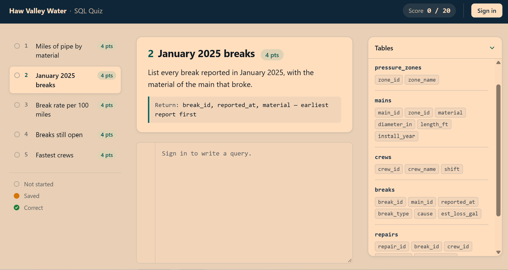
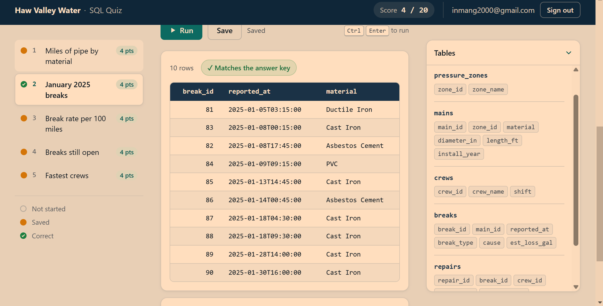
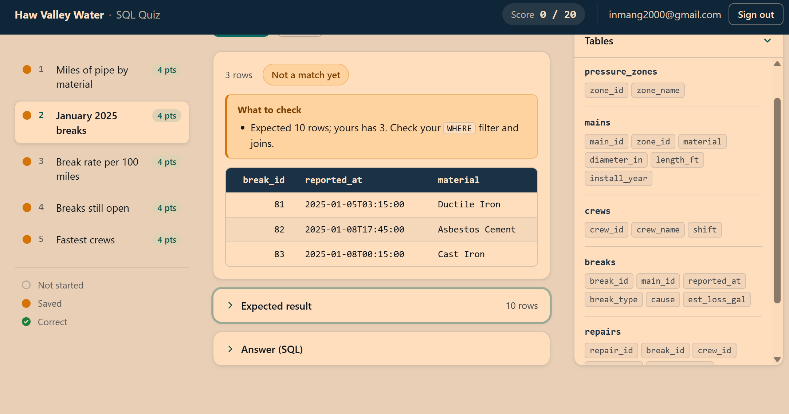
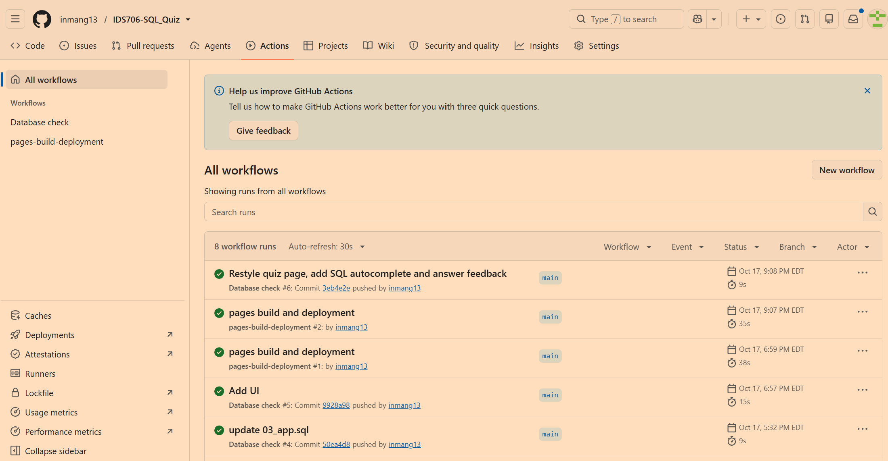

# Haw Valley Water — SQL Quiz

[](https://github.com/inmang13/IDS706-SQL_Quiz/actions/workflows/db-check.yml)

**Quiz site: https://inmang13.github.io/IDS706-SQL_Quiz/**

A five-question, 20-point SQL quiz about water main breaks and repairs at a fictional utility, Haw Valley Water. The data is made up, but shaped like a real utility's records: old cast iron breaks far more often than newer pipe, breaks cluster in winter, and a few breaks are still waiting on a crew.

IDS 706 · Assignment 7 · Grace Inman

---

## Instructions

1. Open the [quiz site](https://inmang13.github.io/IDS706-SQL_Quiz/). Signed out, you can read the questions, but the editor is locked and Run and Save are disabled.
2. Click **Sign in → Create account** with any email and password. Email confirmation is turned off, so you can start right away.
3. Attempt **Question 1** , and press **Run** (or Ctrl+Enter). I've added auto-complete suggestions so it easier to type. 
4. You should see live rows from the database and a ✓ if your output matched the expected output. Use the Hints to guide you. Peak at the answer if needed.
5. Press **Save** (or Ctrl+S), reload the page, and the saved query comes back.

Each question has two collapsed sections: **Expected result** (the result table) and **Answer (SQL)** (the expected query). Results are graded by their values, not by matching the SQL text or the column names.

---

## How it fits together

```
 Browser (quiz site on GitHub Pages: docs/index.html)
   │  sign in / sign up ─────────────▶ Supabase Auth (email + password)
   │  read questions, save answers ──▶ Supabase REST API (row-level security)
   │  Run ───────────────────────────▶ Edge Function "run-sql"
   │                                     │ 1. rejects signed-out users (401)
   │                                     │ 2. runs the SQL as read-only role quiz_reader
   │                                     │ 3. compares the result to the answer key
   │                                     │ 4. writes a row to the audit log
   ▼                                     ▼
                 Supabase PostgreSQL (hosted)
                 quiz.*         quiz data (takers can only read it)
                 public.questions, answers, audit_log

 GitHub Actions ── QUIZ_READER_DATABASE_URL (GitHub Secret) ──▶ same database, read-only role
```

| Requirement | Where it lives |
|---|---|
| Hosted PostgreSQL | Supabase project; quiz data in schema `quiz` (`supabase/01_schema.sql`, `02_seed.sql`) |
| Authentication | Supabase Auth. Signed-out users have no permission on `answers` and get a 401 from `run-sql`. This is enforced by the database and the server, not only by disabling buttons. |
| GitHub Actions + Secrets | `.github/workflows/db-check.yml` connects with the `QUIZ_READER_DATABASE_URL` secret and runs `scripts/check_db.py`. No password appears anywhere in the repo. |
| 20-point SQL quiz with hints | `public.questions` (`supabase/04_questions.sql`). Each question stores its expected SQL and its expected result table. |

---

## The quiz site

- **Question list** with points and status: not started, saved, or correct. Your score is shown in the top bar.
- **Tables panel** listing every table and column, so takers never guess names.
- **SQL editor** ([CodeMirror](https://codemirror.net/5/)) with syntax highlighting and **autocomplete** for SQL keywords and this database's real table and column names. Suggestions appear as you type; Ctrl+Space opens them on demand.
- **Shortcuts:** Ctrl/Cmd+Enter runs, Ctrl/Cmd+S saves.
- **Result table** showing the live rows, the row count, and a ✓ or "Not a match yet" badge. Database errors are shown as-is.
- **Tips on wrong answers.** When a query errors or its result doesn't match, the page points at the likely mistake without giving away the answer: a misspelled table or keyword, whole-number division, missing rounding, a join that repeats rows, `WHERE` used where `HAVING` is needed, the wrong number of columns, and similar.
- **Expected result** and **Answer (SQL)** as separate collapsed sections, closed by default.

The page is a single HTML file with no build step. It uses only the Supabase **publishable** key, which is designed to be public; row-level security and the Edge Function protect the data.

---

## The data

Fictional system: 5 pressure zones, 200 mains (about 132 miles of pipe), 4 crews, 120 breaks from 2023 through 2025, and 116 repairs. Times are local time with no time zone.

| Table | Columns | Notes |
|---|---|---|
| `pressure_zones` | zone_id, zone_name | Areas of the system served at the same pressure |
| `mains` | main_id, zone_id, material, diameter_in, length_ft, install_year | material: Cast Iron, Ductile Iron, PVC, Asbestos Cement |
| `crews` | crew_id, crew_name, shift | Day or Night |
| `breaks` | break_id, main_id, reported_at, break_type, cause, est_loss_gal | One row per reported break |
| `repairs` | repair_id, break_id, crew_id, started_at, completed_at, repair_method, cost_usd | **No row** = no crew assigned yet. **Empty completed_at** = still in progress. |

The data comes from `scripts/generate_seed.py`, which uses a fixed random seed, so it produces exactly the same rows every time.

## The questions (5 × 4 points = 20)

| # | Question | Skills | Common mistake |
|---|---|---|---|
| 1 | Miles of pipe by material | `GROUP BY`, `SUM`, `ROUND` | `length_ft / 5280` divides whole numbers, which drops the fraction (a 4,000-ft main becomes 0 miles). Divide by `5280.0`. |
| 2 | January 2025 breaks | `JOIN`, date range, `ORDER BY` | `reported_at` is a timestamp, so `BETWEEN '2025-01-01' AND '2025-01-31'` stops at midnight on Jan 31. Use `>= '2025-01-01' AND < '2025-02-01'`. |
| 3 | Break rate per 100 miles | Two aggregations combined | Joining breaks to mains and then summing `length_ft` counts a pipe once per break and skips pipes that never broke. Count breaks and miles separately. |
| 4 | Breaks still open | `LEFT JOIN`, `IS NULL`, `CASE` | An inner join drops breaks with no repair row at all. |
| 5 | Fastest crews | Timestamp math, `AVG`, `HAVING` | `COUNT(*)` also counts in-progress repairs unless they're filtered out, and the 20-repair cutoff needs `HAVING`, not `WHERE`. |

Row order counts, because every question states a sort order. Numbers are compared to 2 decimal places.

---

## Extra credit

**Parameterized queries.** The app's own reads and writes (questions, saved answers, audit rows) go through the Supabase client libraries, which send values separately from the SQL text, so they can't be used for injection. The one exception is the taker's query itself, since that *is* the SQL being tested. It runs under the read-only role described below, so it can't change anything.

**Audit log.** `public.audit_log` records every run and every save: who (user id and email), when, which question, the SQL text, whether it worked, and how many rows came back. Runs are logged by the `run-sql` function; saves are logged automatically by a database trigger.

**Integrity check.** Takers cannot alter the log:
- Takers can read only their own log rows and cannot insert, edit, or delete any.
- Triggers block `UPDATE`, `DELETE`, and `TRUNCATE` on the log for everyone.
- Each row stores a SHA-256 fingerprint (hash) of its contents plus the previous row's fingerprint. Changing any past row breaks the chain.
- `select * from verify_audit_log();` recomputes the chain and reports the first row that doesn't match. GitHub Actions runs this check on every run.

### Why takers can't damage the database

Takers' SQL never runs as the database owner. The `run-sql` function connects as `quiz_reader`, a role that can only `SELECT` from the `quiz` tables and has no access to `answers` or `audit_log`. Each query also:
- runs inside a `READ ONLY` transaction with a 5-second timeout,
- must be a single `SELECT` statement (it's wrapped as a subquery, and extra statements are rejected), and
- returns at most 500 rows.

The quiz tables keep row-level security turned on, with a policy that lets `quiz_reader` read them. `scripts/check_db.py` verifies all of this on every CI run.

---

## GitHub Actions

`.github/workflows/db-check.yml` runs on every push to `main`, on pull requests, by hand from the Actions tab, and every Monday. The weekly run also keeps the free Supabase project from pausing.

It installs `requirements.txt`, then runs `scripts/check_db.py` with the connection string from the `QUIZ_READER_DATABASE_URL` repository secret. The check confirms that:
1. all five quiz tables are loaded,
2. the questions total 20 points, and every question's expected SQL still returns its stored expected result,
3. the quiz role has no write privileges and can't read saved answers or the audit log, and
4. the audit log's hash chain is intact.
---

## How I Set it up

With a  free Supabase account and a GitHub account.

### 1. Create the Supabase project
New project → pick a region → save the database password in a password manager, never in this repo.

### 2. Load the database
In the **SQL Editor**, open each file in a text editor, copy its **entire contents** (not the file name), paste, and press Run, in this order:

1. `supabase/01_schema.sql`: tables
2. `supabase/02_seed.sql`: data. Run it once; a second run fails with "duplicate key", which only means the data is already there.
3. `supabase/03_app.sql`: questions, answers, and audit tables; security rules; the read-only role. Safe to re-run.
4. `supabase/04_questions.sql`: the five questions and the answer key.

### 3. Give the read-only role a password
Run this once in the SQL Editor. Use letters and numbers only, because the password goes inside a URL. It is not saved anywhere in git.
```sql
alter role quiz_reader with login password 'PICK_A_LONG_PASSWORD';
```

### 4. Build the connection string
Click **Connect** → **Session pooler** → copy the URI. Change the user from `postgres.<project-ref>` to `quiz_reader.<project-ref>`, insert the password from step 3, and add `?sslmode=require`:
```
postgresql://quiz_reader.<project-ref>:PICK_A_LONG_PASSWORD@aws-0-us-east-1.pooler.supabase.com:5432/postgres?sslmode=require
```
This one string goes in three places: your local `.env`, the Edge Function secret, and the GitHub secret.

### 5. Turn on sign-in
- **Authentication → Sign In / Providers → Email:** enabled, with **Confirm email** turned off so takers can start right away.
- **Authentication → URL Configuration:** set the Site URL and a Redirect URL to the quiz site's address.

### 6. Deploy the `run-sql` function
1. **Edge Functions → Secrets:** add `QUIZ_READER_DATABASE_URL` with the string from step 4.
2. **Edge Functions → Deploy a new function → Via editor:** name it `run-sql`, replace the sample code with `supabase/functions/run-sql/index.ts`, and deploy.

### 7. Check it from your machine
```bash
python -m venv .venv
.venv\Scripts\activate            # macOS/Linux: source .venv/bin/activate
pip install -r requirements.txt
```
Create a file named `.env` in the repo folder containing one line, then save it:
```
QUIZ_READER_DATABASE_URL=<the string from step 4>
```
Then run `python scripts/check_db.py`. Every line should say PASS. `.env` is listed in `.gitignore`; confirm it with `git check-ignore .env`.

### 8. GitHub Actions
Repo → **Settings → Secrets and variables → Actions → New repository secret**: name `QUIZ_READER_DATABASE_URL`, value from step 4. Make sure `main` is the default branch (**Settings → General**), then push or run **Database check** from the Actions tab.

### 9. The quiz site
At the top of the script in `docs/index.html`, set:
```js
const SUPABASE_URL = "https://<project-ref>.supabase.co";
const SUPABASE_ANON_KEY = "<publishable or anon key>";   // Project Settings → API
```
**Never** use the `service_role` / secret key or a database password in the page.
Then **Settings → Pages → Deploy from a branch → `main` → `/docs` → Save**.


## Repository layout

```
docs/index.html            quiz site (GitHub Pages)
supabase/
  01_schema.sql            quiz tables
  02_seed.sql              generated data
  03_app.sql               app tables, row-level security, read-only role, audit log + integrity check
  04_questions.sql         generated questions + answer key
  functions/run-sql/       Edge Function that runs takers' SQL
scripts/
  generate_seed.py         makes 02_seed.sql (fixed random seed)
  questions.py             the five questions
  build_questions.py       makes 04_questions.sql by running each expected query
  check_db.py              the CI health check
  quizdb.py                shared run/compare code (same rules as the Edge Function)
.github/workflows/db-check.yml
CLAUDE_DESIGN_PROMPT.md    the prompt used to generate the quiz page in Claude Design
AI_PROMPTS.txt             log of the prompts given to AI tools while building this project
```

## AI assistance

This project was built with AI help: Claude (model `claude-opus-5-5`) for the database, scripts, Edge Function, workflow, and this README, and Claude Design for the quiz page. Every prompt given to the AI tools is listed in [`AI_PROMPTS.txt`](AI_PROMPTS.txt).

## Known limits

- The database owner (`postgres`) could still disable the audit triggers and rebuild the whole hash chain. The integrity check protects the log from quiz takers, not from the project owner.
- A semicolon inside a quoted string is rejected by the one-statement rule. None of the questions need one.
- Only email and password sign-in is enabled.

## Screenshots

| Signed out (Run disabled) | Correct answer with ✓ |
|---|---|
|  |  |

| Expected result and answer sections | Green GitHub Actions run |
|---|---|
|  |  |
